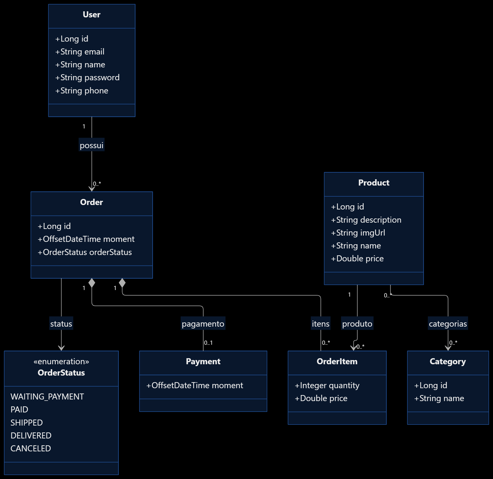

# ProjetoWebService

**RESTful API de e-commerce desenvolvida com Java e Spring Boot**, com foco no gerenciamento de usuários, produtos, categorias e pedidos.

O projeto foi desenvolvido com o objetivo de aplicar conceitos de desenvolvimento back-end, arquitetura em camadas, persistência de dados e mapeamento objeto-relacional (ORM) utilizando Spring Data JPA e Hibernate.

## Tecnologias utilizadas

- **Java 25**
- **Spring Boot 4.1.2**
  - Spring Web MVC
  - Spring Data JPA
  - H2 Console
- **Hibernate** — Mapeamento objeto-relacional (ORM)
- **Banco de dados:** H2 e PostgreSQL
- **Maven** — Gerenciamento de dependências e build

## Arquitetura do projeto

A aplicação utiliza o padrão de arquitetura em camadas (*Layered Architecture*), separando as responsabilidades para facilitar a organização, manutenção e evolução do código.

```text
com.cursojava.projetowebservice
│
├── entities/             # Entidades e modelos de domínio
│   └── pk/               # Chaves primárias compostas
│
├── enums/                # Enumerações do sistema
│
├── repositories/         # Acesso e persistência de dados
│
├── services/             # Regras de negócio
│   └── exceptions/       # Exceções da camada de serviço
│
└── resources/            # Controllers e endpoints REST
    └── exceptions/       # Tratamento global de exceções
```

**Fluxo de uma requisição:**

`Resource (Controller) → Service → Repository → Database`

Cada camada possui uma responsabilidade específica:

- **Resource:** recebe as requisições HTTP e retorna as respostas da API.
- **Service:** concentra as regras de negócio e coordena as operações.
- **Repository:** realiza o acesso e a persistência dos dados.
- **Entities:** representam as entidades do domínio e seus relacionamentos.

## Modelo de domínio

O sistema possui as seguintes entidades e relacionamentos:

| Relacionamento | Descrição |
|---|---|
| User 1:N Order | Um usuário pode possuir vários pedidos. |
| Order 1:N OrderItem | Um pedido pode possuir vários itens. |
| Order 1:1 Payment | Um pedido possui no máximo um pagamento. |
| Product N:N Category | Um produto pode pertencer a várias categorias, e uma categoria pode possuir vários produtos. |
| Order N:N Product | Relacionamento realizado por meio da entidade OrderItem, que contém quantidade e preço. |

### Principais tabelas

- `tb_user`
- `tb_order`
- `tb_order_item`
- `tb_payment`
- `tb_product`
- `tb_category`
- `tb_product_category`

**Observações:**

- O relacionamento entre produtos e categorias utiliza a tabela intermediária `tb_product_category`.
- A entidade `OrderItem` utiliza uma chave primária composta (`OrderItemPK`).
- O status dos pedidos é representado pela enumeração `OrderStatus` e armazenado como inteiro no banco de dados.

## Diagrama UML

O diagrama abaixo representa o modelo de domínio da aplicação, apresentando as entidades, seus atributos e os relacionamentos existentes entre elas.



## Endpoints da API

### Usuários — `/users`

| Método | Endpoint | Descrição | Resposta |
|---|---|---|---|
| GET | `/users` | Lista todos os usuários. | 200 OK |
| GET | `/users/{id}` | Busca um usuário pelo ID. | 200 / 404 |
| POST | `/users` | Cadastra um novo usuário. | 201 Created |
| PUT | `/users/{id}` | Atualiza nome, e-mail e telefone. | 200 / 404 |
| DELETE | `/users/{id}` | Remove um usuário. | 204 / 404 / 400 |

### Produtos, pedidos e categorias

| Método | Endpoint | Descrição |
|---|---|---|
| GET | `/products` | Lista todos os produtos. |
| GET | `/products/{id}` | Busca um produto pelo ID. |
| GET | `/orders` | Lista todos os pedidos. |
| GET | `/orders/{id}` | Busca um pedido pelo ID, incluindo itens, pagamento e total. |
| GET | `/categories` | Lista todas as categorias. |
| GET | `/categories/{id}` | Busca uma categoria pelo ID. |

## Exemplos de requisições

### Cadastro de usuário

**POST** `/users`

Content-Type: `application/json`

```json
{
  "name": "Maria Brown",
  "email": "maria@gmail.com",
  "phone": "988888888",
  "password": "123456"
}
```

## Tratamento de exceções

A aplicação utiliza `@ControllerAdvice` para centralizar o tratamento de exceções e padronizar as respostas de erro da API.

A classe `ResourceExceptionHandler` intercepta exceções específicas e retorna informações estruturadas por meio da classe `StandardError`.

| Exceção | Status HTTP | Descrição |
|---|---|---|
| `ResourceNotFoundException` | 404 Not Found | Recurso não encontrado. |
| `DatabaseException` | 400 Bad Request | Erro relacionado à operação no banco de dados. |

**Exemplo de resposta de erro:**

```json
{
  "timestamp": "2026-11-04T18:30:00Z",
  "status": 404,
  "error": "Resource not found",
  "message": "Resource not found. ID: 99",
  "path": "/users/99"
}
```

## Como executar o projeto

### Pré-requisitos

- JDK 25 ou superior compatível com a configuração do projeto.
- Maven 3.9 ou superior.
- Banco de dados H2 ou PostgreSQL, conforme o perfil de execução configurado.

### 1. Clone o repositório

```bash
git clone <url-do-repositorio>
```

### 2. Acesse o diretório

```bash
cd projetoweb-service
```

### 3. Execute a aplicação

Caso o projeto possua Maven Wrapper:

**Windows:**

```bash
mvnw.cmd spring-boot:run
```

**Linux/macOS:**

```bash
./mvnw spring-boot:run
```

Ou, caso tenha o Maven instalado:

```bash
mvn spring-boot:run
```

A aplicação estará disponível em:

`http://localhost:8080`

## Configuração do banco de dados

O projeto possui dependências para utilização dos bancos de dados H2 e PostgreSQL.

A configuração da conexão deve ser realizada no arquivo `application.properties` ou nos arquivos específicos dos perfis da aplicação.

O Hibernate utiliza a configuração `spring.jpa.hibernate.ddl-auto=update` para atualizar a estrutura das tabelas com base nas entidades mapeadas, quando configurado dessa forma.

### H2 Console

Quando habilitado e configurado, o console do H2 pode ser acessado em:

`http://localhost:8080/h2-console`

A URL JDBC deve corresponder à configuração definida nas propriedades da aplicação.

## Objetivos de aprendizagem

Este projeto permite praticar conceitos importantes do desenvolvimento back-end com Java:

- Desenvolvimento de APIs REST.
- Arquitetura em camadas.
- Programação orientada a objetos.
- Mapeamento objeto-relacional com JPA e Hibernate.
- Relacionamentos entre entidades.
- Persistência de dados com Spring Data JPA.
- Tratamento global de exceções.
- Integração com bancos de dados relacionais.
- Operações CRUD e manipulação de requisições HTTP.

## Autor

**Marcus Santos**

Desenvolvedor Back-End | Java | Spring Boot

[GitHub](https://github.com/MarcuSantosDev)
